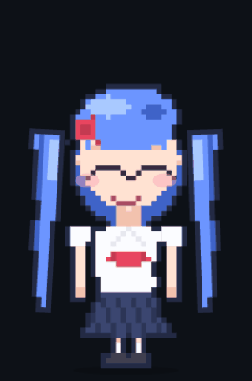

# Mira — a living companion for your desktop

[](LICENSE)
[](https://github.com/LeviTankTV/Friend/releases/latest)
[](https://github.com/LeviTankTV/Friend/actions/workflows/ci.yml)

**[README на русском →](README.ru.md)**

Not an assistant. The one who is nearby.

Mira lives on your desktop: she walks around it, sits on top of your active
window, peeks from behind the screen edge, dances to your music — and she
*remembers you*. She has her own mood, she notices when you've been silent
for an hour, when you've been in the editor for three, when you've been up
past midnight three nights in a row. And she says so — gently, in her own
words.

<p align="center">
  
</p>

Free, open source, cross-platform (Windows / Linux / macOS). Everything that
can work locally, works locally.

## What she does

- **Lives on the desktop, not in a chat window.** Transparent always-on-top
  window: drag her by the sprite, resize with the wheel, park her on the
  taskbar or on top of the active window (she follows it), let her peek from
  the screen edge.
- **Talks.** Connect any OpenAI-compatible LLM — NVIDIA NIM, a local Ollama,
  LM Studio, anything. She answers in character, in one living line, not in
  assistant-speak.
- **Remembers.** `remember: my cat's name is Barsik` — facts go to a local
  SQLite memory with full-text search; every night she compresses the day
  into a note about you. Survives restarts. And you can always look through
  and delete any fact: right-click her → *what she knows*.
- **Feels.** Mood, energy and affection drift on their own: ignore her for
  four hours and you'll hear it in her tone. She reads the *tone* of your
  messages locally (tired? upset? glad?) and responds with empathy — she
  just changes her face and her words, and never tells you she "analyzed"
  you.
- **Notices.** What app you're in (code / browser / game / messenger), how
  long, whether you're at the keyboard at all. She speaks first — to say
  good morning, to nudge you toward a glass of water, to tell you to go to
  bed at 3 AM, to ask "you there, everything okay?" after an hour of
  silence, or to tease you about the game you've been playing for two hours.
- **Speaks and hears.** Her lines are voiced (Edge TTS, quieter at night);
  you can talk to her by voice — recognition runs **locally** (faster-whisper),
  and she wakes when you say her name. All of it optional, off by default
  where it needs a microphone.
- **Reacts to you.** Pet her head — hearts. Click her — a short line, she
  won't turn into a vending machine. Play music — she dances. Leave — she
  yawns, falls asleep and eventually walks off to the screen edge to sleep.

## Why Mira and not …

| | Desktop Mate | Shimeji | Open-LLM-VTuber | **Mira** |
|---|---|---|---|---|
| Lives on the desktop (walks, sits on windows, peeks) | ✅ | ✅ | ❌ (a chat window) | ✅ |
| Real conversation with memory | ❌ | ❌ | ✅ | ✅ |
| Own mood that you can hurt or lift | ❌ | ❌ | ❌ | ✅ |
| Notices your context (app, idle, sleep patterns) and speaks first | ❌ | ❌ | ❌ | ✅ |
| Local speech recognition (nothing leaves the machine) | ❌ | ❌ | ✅ | ✅ |
| Free & open source | ❌ (paid) | ✅ | ✅ | ✅ |

Desktop pets are cute for two days. Chatbots are useful but invisible. Mira
is the combination: a presence on your desktop with a memory and a temper.

## Privacy, honestly

| Data | Where it goes |
|---|---|
| Your voice (mic button, wake word) | **Nowhere.** faster-whisper runs locally; recordings are deleted right after transcription |
| Memory, facts, conversation archive | **Nowhere.** Local SQLite file |
| What app/window you're in | Only into the LLM prompt text (the app name + window title), to your LLM provider |
| Her spoken replies | The reply **text only** goes to Microsoft Edge TTS to be voiced. Turn voice off — nothing leaves at all |
| With a local Ollama + voice off | **Nothing leaves the machine. Ever.** |

No telemetry, no accounts, no analytics. The server listens on
`127.0.0.1` only.

## Quick start

1. **Grab an installer** from
   [Releases](https://github.com/LeviTankTV/Friend/releases) — Windows (NSIS),
   Linux (AppImage / deb), macOS (dmg, Intel + Apple Silicon).
2. **Give her a brain** — one of:
   - a free NVIDIA NIM API key (fast cloud models), or
   - a local [Ollama](https://ollama.com) (`ollama pull llama3.1` and point
     the config at it) — fully offline,
   - any OpenAI-compatible endpoint.
3. *(Optional)* **Give her a voice**: `pip install edge-tts` and a local
   `pip install faster-whisper` for voice input.

From source instead: `start.bat` (Windows) / `start.sh` (Linux) /
`start.command` (macOS) — checks Go and Node, builds, runs. You need
Go 1.24+ and Node 18+.

## Make her yours

- **Her personality** is a single editable JSON (`mira.json`) — name,
  character, likes, example lines, hard rules. Change it, restart, no
  rebuild. `-dump-persona` prints a template (ru or en).
- **Her look**: ship your own sprite sheet (PNG frames + a `sheet.json`)
  and she'll use it instead of the built-in pixel art — walk, blink, sleep,
  dance frames all just work.
- **Her language**: RU/EN in the right-click menu, live — she re-reads her
  character file, swaps prompts, voice and wake word, no restart.
  `avatar.language: "ru" | "en"` in the config sets the starting language.

## Honest limitations

| | Windows | Linux | macOS |
|---|---|---|---|
| Companion, chat, memory, voice | ✅ | ✅ | ✅ |
| Knows the active window | ✅ | ✅ X11 (Wayland — no global tracking, by design) | ✅ app name only (no window titles — needs Accessibility permission) |
| Dances to system audio | ✅ | ✅ PulseAudio / PipeWire | ❌ no system loopback in macOS; she dances to her own voice only |
| Tray & autostart | ✅ | ✅ (desktop file) | ✅ |

## How it works

Go server (no cgo, pure Go SQLite) keeps state, memory, the proactive
scheduler and the persona; a vanilla JS + PixiJS page draws the procedural
pixel character; a thin Electron shell gives it the transparent always-on-top
window and spawns the per-platform helpers (active window watcher, system
audio level). Every design decision and the bugs found on the way are
written down in [PLAN.md](PLAN.md) — it doubles as the dev log.

```
server/   Go: companion, memory (SQLite+FTS5), mood, proactive, tts/stt, wake
web/      The character: PixiJS avatar, chat, menu, music, idle watcher
desktop/  Electron shell: transparent window, tray, helpers, selftest
```

Run the full self-check any time: `cd desktop && npx electron . --selftest`
(31 checks, exit 0 on a healthy machine).

## How it was built

Developed with an AI assistant under human direction. Every design
decision, measurement and dead end is written down in [PLAN.md](PLAN.md)
(in Russian) — a dev diary where the discipline is *measurements over
vibes*: voice latency, RAM of both shells, what breaks on which runner.
Every behavior is covered by a 31-part self-test and CI on three OSes.
If something looks wrong to you, the journal is there to prove it right
or wrong — that is the whole point of it.

A character gallery, live language switching and a weekly-rhythm pattern
shipped after the 0.1.0 tag — see [CHANGELOG.md](CHANGELOG.md).

## Roadmap

- More languages (the i18n registry is done — a language is one
  `Register()` plus its dictionary; ru/en now)

Contributions welcome — pick something from PLAN.md, the discipline there
is: measurements over vibes.

---

*Repo name is `Friend`; the companion herself is **Mira** (Мира).*
